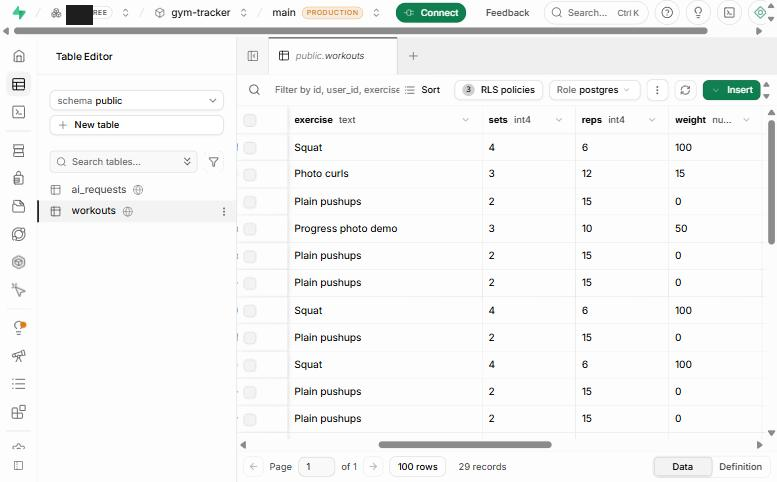
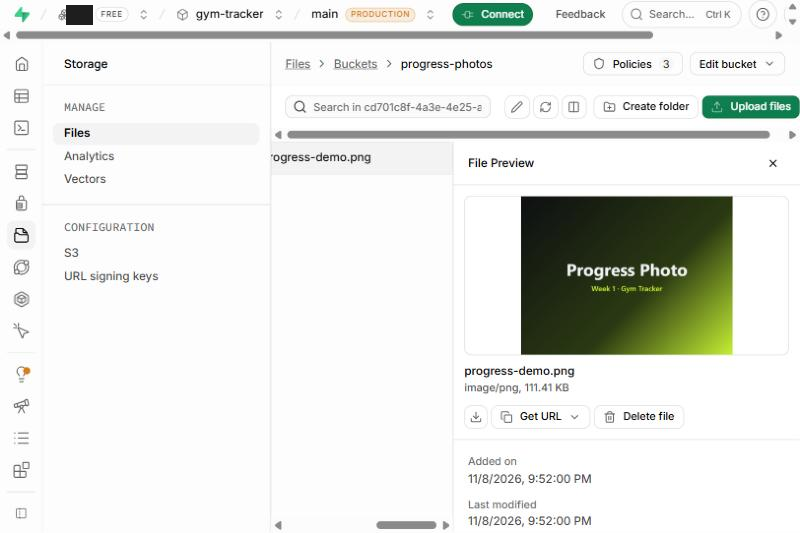
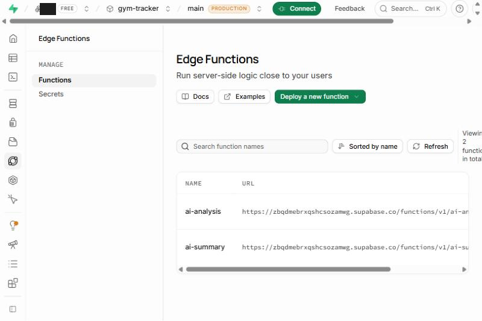
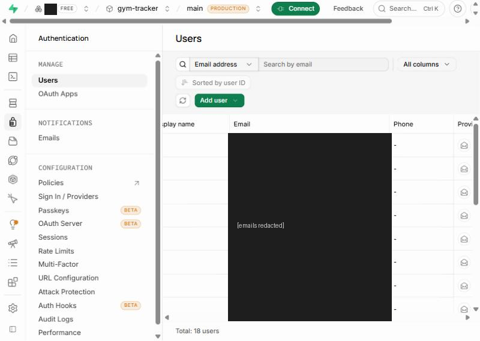
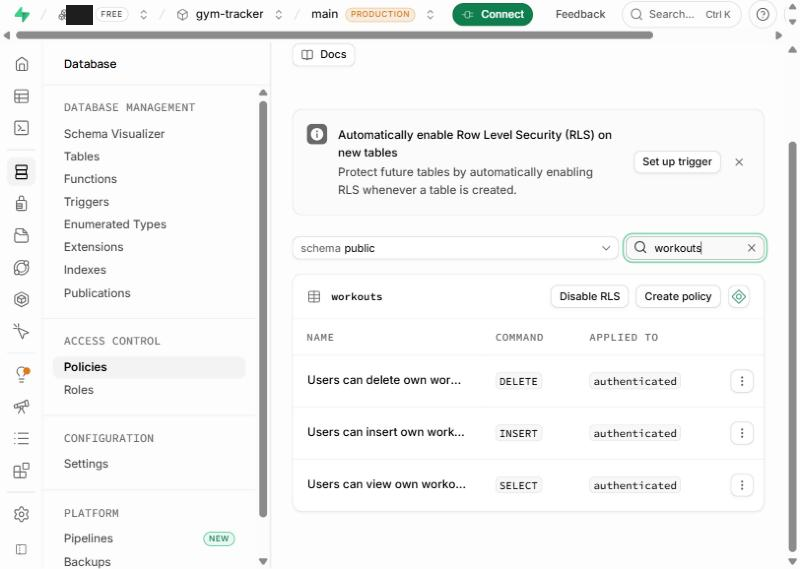

# DATABASE.md - Gym Tracker (Day 7: Build Your First Table)

Supabase project: `gym-tracker` (ref `zbqdmebrxqshcsozamwg`, region eu-central-1, Postgres 17).
Everything below was read from the live project on **2026-11-10** with SQL against `information_schema` / `pg_policies` and the `workouts` table itself.

## Table: `public.workouts`

One row = one logged exercise (what, how many sets/reps, how heavy, when).

| Column | Type | Nullable | Default | What it stores |
|---|---|---|---|---|
| `id` | `uuid` | NO | `gen_random_uuid()` | Primary key. Unique id of the workout row. |
| `user_id` | `uuid` | NO | `auth.uid()` | Owner of the row (foreign key to `auth.users.id`). Filled by the database from the logged-in session, never sent by the browser. |
| `exercise` | `text` | NO | - | Exercise name, e.g. "Squat". Check: 1-100 characters after trimming. |
| `sets` | `integer` | NO | - | Number of sets. Check: `sets > 0`. |
| `reps` | `integer` | NO | - | Repetitions per set. Check: `reps > 0`. |
| `weight` | `numeric` | NO | `0` | Weight used in kg (0 = bodyweight). Check: `weight >= 0`. |
| `created_at` | `timestamp with time zone` | NO | `now()` | When the row was created (set automatically, UTC). |
| `photo_url` | `text` | YES | - | Optional progress photo. Despite the name it stores the **Storage path** `<user_id>/<file>` in the private `progress-photos` bucket (the site turns it into a short-lived signed URL). Added by a later migration. |
| `summary` | `text` | YES | - | Optional AI/hand-written session summary, max 1000 characters. Added by a later migration. |

`id` and `created_at` are both present and **NOT NULL** (verified: 0 rows with a null `id` or `created_at`).

The Day 7 core of the table is `id, exercise, sets, reps, weight, created_at`. `user_id` (ownership for login/RLS) and `photo_url` / `summary` (photos and AI summary) were added by later migrations; nothing was removed.

## Row-level security (read from `pg_policies`)

RLS is enabled. Policies (all for role `authenticated`): `Users can view own workouts` (SELECT), `Users can insert own workouts` (INSERT), `Users can delete own workouts` (DELETE). There is no UPDATE policy. A signed-in user only sees, adds and deletes their own rows. The SQL below was run with the project's admin SQL access, which bypasses RLS, so it sees every user's rows; the website itself never does.

## Data in the table (verified 2026-11-10)

- **29 rows**, from 15 different accounts (the repo's automated tests sign up fresh accounts, so many rows are test data).
- First row: 2026-11-08 15:11 UTC. Last row: 2026-11-08 20:30 UTC.
- At least three realistic workouts exist, so no extra test rows were inserted for this submission.

## Screenshot

`docs/screenshots/day7-workouts-table.png` - Supabase Table Editor, tab `public.workouts`, footer showing **29 records**, with the `exercise`, `sets`, `reps` and `weight` columns and 11 visible workout rows (captured 2026-11-10).



## Query 1 - Which workout has the highest weight?

```sql
select exercise, sets, reps, weight, created_at
from public.workouts
order by weight desc, created_at desc
limit 3;
```

Result (actual output):

| exercise | sets | reps | weight | created_at (UTC) |
|---|---|---|---|---|
| Squat | 4 | 6 | 100 | 2026-11-08 20:23:28 |
| Squat | 4 | 6 | 100 | 2026-11-08 20:22:37 |
| Squat | 4 | 6 | 100 | 2026-11-08 20:20:51 |

**Answer:** the heaviest workout is the **Squat at 100 kg (4 sets x 6 reps)**. Several identical Squat rows share that maximum (they are repeated test entries), so the top rows tie at 100 kg; `created_at desc` is used only to order the tie.

## Query 2 - What workouts were recorded most recently?

```sql
select exercise, sets, reps, weight, created_at
from public.workouts
order by created_at desc
limit 5;
```

Result (actual output):

| exercise | sets | reps | weight | created_at (UTC) |
|---|---|---|---|---|
| Photo curls | 3 | 12 | 15 | 2026-11-08 20:30:28 |
| Plain pushups | 2 | 15 | 0 | 2026-11-08 20:30:26 |
| Squat | 4 | 6 | 100 | 2026-11-08 20:23:28 |
| Plain pushups | 2 | 15 | 0 | 2026-11-08 20:23:24 |
| Squat | 4 | 6 | 100 | 2026-11-08 20:22:37 |

**Answer:** the newest workout is **Photo curls (3 x 12 at 15 kg)**, recorded 2026-11-08 20:30 UTC, followed by Plain pushups (bodyweight).

## Where the schema comes from

`supabase/migrations/` (apply in filename order): `20261108_create_workouts_table_with_rls.sql`, `20261108_photos_and_summary.sql`, `20261108_rename_to_progress_photos.sql`, `20261108_ai_rate_limit.sql`.
Related table `public.ai_requests` (id, user_id, created_at) only supports the AI rate limit; RLS is on with no policies (server-side use only).

---

# Day 8 - Files and Server Logic (verified against the live project, 2026-11-10)

## Storage bucket `progress-photos`

| Setting | Value (read from `storage.buckets`) |
|---|---|
| Public | **No (private)**. The Day 8 handout starts with a public bucket "because there are no logins yet"; this project already has logins, so the bucket was locked down. Photos are shown with short-lived signed URLs. |
| File size limit | 5,242,880 bytes (5 MB), enforced by the bucket |
| Allowed types | `image/jpeg`, `image/png`, `image/webp`, `image/gif` (enforced by the bucket) |
| Policies (`storage.objects`) | `Users upload own progress photos` (INSERT), `Users view own progress photos` (SELECT), `Users delete own progress photos` (DELETE), all for `authenticated`, limited to the folder `<user_id>/` |

Contents: **6 objects**, all PNG, every one referenced by exactly one `workouts.photo_url` (0 dangling references). One is a 114 KB demo image (`progress-demo.png`); the other five are tiny 78-byte test images from the automated tests.

## Column `workouts.photo_url`

`text`, nullable (the photo is optional). Stores the object path `<user_id>/<file>`, not a public URL, because the bucket is private. 6 rows have a photo and 23 do not (`summary` is also optional text: 10 rows have one).

## Edge Functions (both `ACTIVE`, version 7, `verify_jwt = true`)

- `ai-summary` - receives exercise, sets, reps, weight; returns a short summary through OpenRouter using a `:free` model (model discovery + fallback in `supabase/functions/ai-summary/shared.ts`, paid models are never called). The website puts the result in an editable box; if the AI fails the user can write the summary by hand and the workout still saves.
- `ai-analysis` - reads the caller's last 7 days of workouts with the caller's own JWT (RLS applies) and names under-trained muscle groups.
- Shared limit: **5 AI requests per rolling minute per user**, across both functions, enforced in Postgres by `public.consume_ai_request(p_user, p_limit => 5, p_window => 1 minute)` (advisory-locked; requests logged in `public.ai_requests`). The 6th call gets HTTP 429 and a `Retry-After`.

## Secret handling

- `OPENROUTER_API_KEY` is read only with `Deno.env.get('OPENROUTER_API_KEY')` inside the Edge Functions.
- Searched on 2026-11-10: no `sk-or-...` string in the current source, in the full git history, or in the live production JavaScript bundle. `.env*` is git-ignored; only `.env.example` (placeholders) is tracked. The browser only receives the Supabase URL and publishable key.

## What was and was not verified

Verified today by direct inspection (SQL, project API, source, live bundle): bucket settings and policies, stored files, `photo_url` consistency, both functions deployed with JWT verification, the rate-limit function definition, no key in source/history/bundle, live site responds (HTTP 200).

Not re-run today: the signed-in browser flows (upload, preview, replace, 5 MB rejection, AI suggestion, 7-day analysis, the 429 message) because they need a signed-in account and genuine AI calls use the shared free quota (50 free-model requests/day, see README). Earlier evidence in `docs/screenshots/e2e-*` came from a test run on 2026-11-08, and **its AI-summary step used a stubbed browser response (the text starts with "MOCK:")**, so those images are not proof of genuine AI output. The database does hold four natural-language summaries from 2026-11-08 (each ending "(edited by me)") that are consistent with genuine suggestions that were then edited, but that is circumstantial. The `OPENROUTER_API_KEY` secret was confirmed to exist in Supabase -> Edge Functions -> Secrets (name and last-updated time 2026-11-08 19:19 UTC only; its value is not readable by design and was not viewed).

## Still open on purpose

Free-tier daily AI quota is shared by every `:free` model; the bucket is private (stricter than the handout's temporary public bucket); there is no UPDATE policy on `workouts`.

## Day 8 submission screenshots (captured 2026-11-10 from the Supabase dashboard)

1. `docs/screenshots/day8-storage-progress-photos.png` - Storage -> bucket `progress-photos` -> folder `<user_id>/` -> `progress-demo.png` (image/png, 111.41 KB) with its preview.
2. `docs/screenshots/day8-edge-functions.png` - Edge Functions list showing `ai-analysis` and `ai-summary` with their `functions/v1` URLs.




---

# Day 9 - Making Data Yours (checked against the live project, 2026-11-10)

## Row Level Security on `public.workouts`

- RLS **enabled** (`relrowsecurity = true`).
- `workouts.user_id uuid NOT NULL DEFAULT auth.uid()`, `FOREIGN KEY (user_id) REFERENCES auth.users(id) ON DELETE CASCADE`. The owner id is filled by the database from the logged-in session; the app never sends it.
- Policies (all `TO authenticated`, condition `(select auth.uid()) = user_id`): `Users can view own workouts` (SELECT), `Users can insert own workouts` (INSERT, `WITH CHECK`), `Users can delete own workouts` (DELETE). There is no UPDATE policy and no policy for `anon`.

## Tests that were actually run

**A. Real policies, two real user ids, inside one transaction that was rolled back** (SQL with `SET LOCAL ROLE authenticated` / `anon` and `request.jwt.claims` set to the user's id, then `RAISE EXCEPTION` so no test write survived; afterwards 29 rows and 0 leftovers):

| # | Check | Result |
|---|---|---|
| 1 | User A selects workouts | sees only own rows (3) |
| 2 | User A sees rows owned by other users | 0 |
| 3 | A inserts without `user_id` | owner is A (default `auth.uid()`) |
| 4 | A inserts a row with B's `user_id` (forged) | rejected: `new row violates row-level security policy` |
| 5 | B reads A's workout by id | not visible |
| 6 | B deletes A's workout | 0 rows deleted |
| 7 | Logged-out (`anon`) select | 0 rows |
| 8 | Logged-out (`anon`) insert | rejected by RLS |

**B. Logged-out requests to the live REST API** (publishable key only, no login): `GET /rest/v1/workouts` -> `[]` (HTTP 200); `POST` -> HTTP 401, code `42501` (RLS violation); `DELETE` -> `[]`, nothing removed.

**What this does NOT cover:** these were run directly against the database/API, not by signing in to the website as two people. The repo's `tests/rls.test.mjs` does that with two real accounts but needs a credentials file for two accounts that I did not create; run it with your own two test accounts (`node --env-file=.env tests/rls.test.mjs creds.json`).

## Authentication (Supabase Auth)

- Email provider enabled; "Allow new users to sign up" ON; anonymous sign-ins OFF; manual linking OFF.
- **"Confirm email" is OFF** (read from the dashboard, not changed). This is deliberate for the classroom project (Supabase's built-in mailer is limited to a few emails per hour, which broke signup with `over_email_send_rate_limit`). For production, turn it on and add a custom SMTP provider. No rate limit or paid setting was changed.
- `auth.users` holds **18** accounts (all created 2026-11-08; 0 in the last 24 h), almost all `<test-account email>` test accounts from the end-to-end tests (`gtuidesktop...`, `gtuimobile...`), one other address. Screenshot below.
- Signup form, login, logout, redirect and session persistence were **not** exercised by me today (that requires creating/using a password account on the hosted project). They were exercised by the 2026-11-08 end-to-end run (`tests/e2e.test.mjs`, "22 checks in real Chrome with a brand-new account created through the signup form"), per the README, but I have not re-run it.

## Extension A - Profile page

New tab "حسابي" (sidebar on desktop, fifth icon in the mobile bottom bar): shows the account email (read-only) and an editable display name saved with `supabase.auth.updateUser({ data: { display_name } })`, i.e. in **Auth user metadata**, not in a table. The name also replaces the email in the top bar. Checked in a local mock-session harness only (layout and form logic); saving to the real Supabase user was not exercised.

## Extension B - verified above

Forged `user_id` (test 4), anonymous access (tests 7-8 and the live REST calls), cross-account isolation (tests 2, 5, 6).

## Day 9 submission screenshots

1. `docs/screenshots/day9-auth-users.png` - Authentication -> Users (Email column, `Total: 18 users`).
2. `docs/screenshots/day9-rls-policies.png` - Database -> Policies filtered to `workouts`: DELETE, INSERT, SELECT, applied to `authenticated`.




---

# Day 9 update (2026-11-10): profile table, Arabic auth errors, password recovery, demo booking foundation

Migrations (applied to the live project and saved in `supabase/migrations/`): `20261110_profiles.sql`, `20261110_booking_foundation.sql`.

## `public.profiles` (replaces the metadata-only display name from Extension A)

| Column | Type | Rules |
|---|---|---|
| `user_id` | `uuid` PK, default `auth.uid()`, FK `auth.users` (cascade) | one row per user |
| `full_name` | `text` null | 1-80 chars |
| `date_of_birth` | `date` null | >= 1900-01-01 (check) and not in the future (trigger). **Age is not stored**; the app computes it from this date. |
| `height_cm` | `numeric(5,1)` null | 50-260 |
| `weight_kg` | `numeric(5,1)` null | 20-400 |
| `updated_at` | `timestamptz` | set by trigger |

RLS: select / insert / update only where `auth.uid() = user_id`; no delete policy; `anon` has no privileges. The «حسابي» screen loads this row on any device, validates the fields in Arabic, upserts it, and shows "تم حفظ بياناتك بنجاح ✓". No calorie targets, body comparisons or weight advice exist anywhere in the profile.

## Booking foundation (DEMO only; no payment gateway, no Pay button, no real appointments)

- `public.services`: `id, name, description, price_kwd numeric(8,3), is_available, is_demo, created_at`. Seeded with 4 fictional services, all labelled "(تجريبي)": 3.000 / 12.000 / 18.500 / 8.000 KWD. Signed-in users may only read available services; nobody can write them through the API.
- `public.bookings`: `id, user_id (default auth.uid()), service_id, scheduled_at, booking_status (pending|confirmed|cancelled), payment_status (pending|awaiting_payment|paid|failed|expired, default pending), price_kwd, created_at, updated_at`.
- **Price is server-side:** the browser sends only `service_id` and `scheduled_at`. Column-level privileges (`grant insert (service_id, scheduled_at)`) mean a customer cannot even send a price, owner or status; a trigger copies the price from `services` and validates the time (between 1 hour and 90 days ahead) and that the service is available.
- **Customers cannot touch `payment_status`:** not on insert, not on update (no update column privilege, and an admin-only update policy limited to `booking_status`). It is reserved for a future Edge Function using the service role (the triggers allow `postgres` / `service_role` only).
- Policies: customers select their own bookings and insert their own `pending` bookings; no delete anywhere.
- **Admin:** `public.admins(user_id)` lists admin accounts; RLS on with no policies and no grants, so the API can never read or change it. `public.is_admin()` (security definer, returns only whether the caller is listed) gates the admin policies and the dashboard section in the app. **No admin exists yet.** To make one, run in the Supabase SQL editor: `insert into public.admins(user_id) select id from auth.users where email = '<your email>';`
- App: new tab «احجز جلسة» (sidebar item / bottom-bar icon): demo banner, service cards with KWD price, date-time picker, confirmation screen (price read back from the server row, booking and payment status chips), "my bookings" list, and an admin section (all bookings, confirm/cancel) visible only when `is_admin()` is true.

## Auth changes

- Every Supabase auth error is mapped to a Kuwaiti Arabic message (wrong credentials, existing email, weak password, unconfirmed email, rate limit, bad email, network); no raw English message is shown.
- Password recovery did not exist; added: "نسيت الرقم السري؟" sends `resetPasswordForEmail` (redirect to the site); opening the link fires `PASSWORD_RECOVERY` and the app shows a set-new-password screen (`updateUser({ password })`). The login method is unchanged and no limits were touched. Supabase's built-in email sender is rate limited, and the site URL must be allowed in Auth -> URL Configuration for the link to return to the app.

## Tests actually run for this update

All SQL below ran against the live project as the real roles (`authenticated`/`anon`, JWT claims set to real user ids) inside one transaction that ended in `RAISE EXCEPTION`, so nothing persisted (afterwards: profiles 0, bookings 0, admins 0, services 4, workouts 29). A temporary admin was inserted inside that transaction only.

| ID | Check | Result |
|---|---|---|
| P1 | User A creates own profile, `user_id` filled automatically | PASS |
| P2 | A inserts a profile for B | PASS (rejected, 42501) |
| P4/P5 | height 10 cm; date of birth in the future | PASS (rejected, 23514) |
| P6 | A updates own profile | PASS |
| P7/P8 | B reads / updates A's profile | PASS (0 rows) |
| P9 | logged-out read | PASS (rejected) |
| B1/B2 | A sees the 4 services; A writes a service | PASS / PASS (rejected) |
| B3 | A books: status pending/pending, price 12.000 = service price, owner = A | PASS |
| B4/B5/B6 | customer sets `payment_status = paid` / sends a price / forges `user_id` | PASS (all rejected, 42501) |
| B7/B8/B9 | past time; more than 90 days ahead; unknown service | PASS (all rejected, 23514) |
| B10/B11/B12 | customer confirms own booking (0 rows); updates payment_status (rejected); deletes (rejected) | PASS |
| B13-B15 | A sees own booking; B sees only B's booking and none of A's | PASS |
| B16/B17 | logged-out read of bookings / services | PASS (rejected) |
| A1-A3 | `is_admin()`: false for customer, true for the (temporary) admin; customer cannot read `admins` | PASS |
| A4/A5 | admin sees all bookings and confirms one | PASS |
| A6 | admin tries to change `payment_status` | PASS (rejected) |

Also run: `npm run build` (passes, TypeScript clean); a local mock-session harness (not the real backend) showing the booking flow, confirmation screen with no Pay button, admin section visibility, the profile age calculation (born 1995-05-05 -> 31 on 2026-11-10) and native validation of height 10. Supabase security advisor: only expected notices (`admins` and `ai_requests` have RLS and no policies on purpose; `is_admin()` is callable by signed-in users on purpose; leaked-password protection is off on the project, which I did not change).

## NOT verified (needs a person signing in on the live site)

Signup, login, logout, redirects, session persistence, the Arabic error text appearing in the real forms, the password-recovery email and link round trip, saving and reloading the profile as a real user, booking through the real website, and the admin screen with a real admin account. I cannot create accounts or enter passwords on the hosted project. Admin authorization was tested at the database level only.

## Live end-to-end test (not run by the assistant)

`tests/day9-live.e2e.mjs` covers the signed-in checks in one command: `node tests/day9-live.e2e.mjs` (real Chrome, real site, two accounts created through the signup form with generated passwords that are never printed). It checks signup/login/logout/refresh persistence, Arabic wrong-password error, 3 workouts per account A, isolation and no-delete for account B, forged `user_id`, profile save + refresh + fresh-session login, demo booking + persistence, cross-account booking access, `payment_status`/price protection, absence of the admin section and `is_admin() = false`, and logged-out access. It prints the SQL to remove only that run's two accounts. **Status: executed on 2026-11-10 against the live site and the real Supabase project (headless Chromium on Linux via `CHROME_PATH`, no mocks): run `mwaqrh1g`, 25 passed, 0 failed.** Passed: signup, session persistence after refresh, logout, wrong-password Arabic error, login; 3 workouts for A persisted; B saw none of A's workouts (UI and REST), could not read or delete them, and a forged `user_id` insert was rejected; profile saved and persisted after refresh and in a fresh session, B's profile was empty, invalid height rejected; demo booking created with server price and no Pay button, persisted as pending; B could not read or modify A's booking or `payment_status`; customers cannot set `payment_status`/price or confirm their own booking; non-admins see no admin section and `is_admin()` is false; logged-out client cannot read bookings, profiles, services or admins. The run created two test accounts (`<test-account email>`, `<test-account email>`) and their rows; they were left in place (no cleanup SQL was run). No code fixes were needed. A positive admin-permission check (an actual admin seeing the dashboard) was not covered by this script. Password recovery (redirect/email round trip) and the Auth URL Configuration page were also not checked (dashboard not signed in for the assistant's browser).

## Admin permissions: positive check (2026-11-10)

**Mechanism (unchanged):** `public.admins` (RLS on, no policies, no API access) + `public.is_admin()` (`security definer`, executable by `authenticated` only). `bookings` RLS lets admins read/update all rows; the dashboard calls `is_admin()` and then queries, so hiding the UI alone grants nothing. No RLS policy or function was changed.

**Grant:** after the owner confirmed the email, one row was inserted into `public.admins` for `<admin email>` (`insert ... select id from auth.users where email = ... on conflict do nothing`). Nobody else is an admin (`admins` has exactly 1 row). No existing user or booking data was modified; no service-role key was used.

**Verified at the database level (authenticated role + JWT claims inside a rolled-back transaction):**
- admin user id: `is_admin() = true`, sees 1 booking (all bookings);
- an unrelated user id: `is_admin() = false`, sees 0 bookings.

**Verified in the real deployed app** with `node tests/admin-live.e2e.mjs` (run `mwas0frp`: 5 passed, 0 failed, 3 skipped). It created one new normal account and one demo booking for it. Passed: normal user sees no admin dashboard and `is_admin()` is false; normal user cannot read or write `admins`; normal user sees only their own booking and cannot change its status; logged-out client reads nothing from `bookings`/`admins`.

**NOT verified yet (skipped, not claimed):** the admin's browser login showing the dashboard, the admin seeing the normal user's booking in the dashboard, and the admin creating a demo booking. They need the admin's real password, which the assistant does not have and must not be given in chat. To run them on your own machine, run `node tests/admin-live.e2e.mjs`; it asks for the admin password with hidden input (not echoed, not in the command line or shell history).
Note that run adds one demo booking owned by the admin. Test accounts created: `<mailbox>+adminlive<run>u@<domain>`; none were deleted.

### Admin visibility investigation (2026-11-10, read-only; nothing changed)

Report: logged in as the admin account, the admin section was not seen. Checked in the real project:
- `public.admins` contains exactly one row, user id `<admin user id>` = `<admin email>` (email confirmed). It is the account with the three recent browser sessions (Windows browser, latest 14:27 UTC, after the grant). No other account has a recent session.
- `public.is_admin()` is `security definer`, `search_path = public`, `exists(select 1 from admins where user_id = auth.uid())`; `authenticated` can execute it, `anon` cannot. With that user's claims (rolled-back transaction) it returned `true` and the role could read all bookings; an unrelated user id returned `false`.
- The live bundle contains the admin section and the `is_admin` RPC call; the API log shows `POST /rest/v1/rpc/is_admin` answering HTTP 200 (response bodies are not logged).
- By design the admin dashboard is not a navigation item: it renders at the bottom of the «احجز جلسة» tab, under the user's own bookings (`src/BookingView.tsx`, `{isAdmin && <section aria-label="لوحة الإدارة">`).
Result: no defect found in the grant, function, policies or deployed code. NOT verified: what the browser actually displayed for the admin (needs the admin's authenticated browser; see the Network check in the chat reply / `tests/admin-live.e2e.mjs`).

### Admin dashboard: USER-VERIFIED results (2026-11-10)

Verified **by the project owner** on the live site while signed in as the admin account (`<admin email>`), per the owner's own report and screenshots. The assistant did not see the browser session and did not run an automated admin login, so these two items are user-verified, not assistant-verified.

| Check | Status |
|---|---|
| Admin dashboard («لوحة الإدارة») visible after admin login | USER-VERIFIED |
| Dashboard lists demo bookings with dates, prices, booking status and payment status | USER-VERIFIED |
| Confirm / Cancel buttons are displayed | USER-VERIFIED (shown only; not clicked) |
| Confirm / Cancel actions work (status changes, payment_status stays untouched) | NOT TESTED |
| Admin creates their own demo booking | NOT TESTED |
| Automated admin login (`tests/admin-live.e2e.mjs`, admin steps) | NOT RUN (3 steps skipped) |

Already verified earlier by automated tests: non-admin accounts see no dashboard, `is_admin()` is false for them, they cannot read/write `admins` and cannot see other users' bookings. No data or permissions were changed for this update (documentation only).

### Admin Confirm / Cancel: verification (2026-11-10)

**Method and limits.** The assistant cannot sign in as the admin (no password), so the browser buttons were NOT clicked by the assistant. The same database path the buttons use (`update bookings set booking_status = ...`, executed by the `authenticated` role under RLS and the `bookings_before_update` trigger) was run with the admin's real user id as the JWT subject, on ONE test booking created by the assistant's own test account (`4da75c50-…`, owner `<test-account email>`). The other two bookings and all user data were untouched; no cleanup SQL was run.

| Check | Result |
|---|---|
| Admin Confirm: `pending` → `confirmed`, committed | PASS (database level) |
| Confirm persisted in a separate later query, `payment_status` still `pending`, price still 12.000 | PASS (database level) |
| Admin Cancel: `confirmed` → `cancelled`, committed | PASS (database level) |
| Cancel persisted in a separate later query, `payment_status` still `pending` | PASS (database level) |
| Admin trying to change `payment_status` | PASS (rejected: permission denied; rolled back) |
| Booking owner (non-admin) trying to confirm own booking | PASS (0 rows changed; rolled back) |
| Same test booking's other two bookings unchanged (`pending`/`pending`) | PASS |
| Clicking أكّد / إلغاء in the live browser as admin, then refreshing | NOT RUN by the assistant |

The test booking is left in status `cancelled`. `tests/admin-live.e2e.mjs` now contains a browser step that clicks Confirm then Cancel on its own run's test booking, reloads after each, and checks `payment_status` stays `pending`; run it locally with `node tests/admin-live.e2e.mjs` (hidden password prompt). It has not been executed, so the browser-level result is unverified. No payment processing was implemented.


## Migration to the `afhaasan` Vercel account (2026-11-10)

The previous Vercel team was deleted, so the old URL stopped serving (HTTP 404). The app was redeployed from this repository's `main` under a Hobby account.

- **Production URL:** https://gym-tracker-afhaasan.vercel.app (aliases `gym-tracker-nu-tan.vercel.app`, `gym-tracker-git-main-afhaasan.vercel.app`). Deployment READY, HTTP 200, static assets (3D model, foods JSON) served.
- **Same Supabase project and data** (unchanged: no new project, no data deleted, no RLS or auth change). Vercel holds only `VITE_SUPABASE_URL` and the publishable key. No secrets in Vercel; the OpenRouter key stays in Supabase Secrets.
- **Deployment Protection (Vercel Authentication) was turned OFF** for this project so the public site is reachable without a Vercel login; all data protection is Supabase RLS.
- **Independence audit:** no team name, Vercel config, CI workflow or hook in the repository; the only hardcoded host was the old URL (README and test defaults, now replaced); Edge Functions answer CORS with `*`, so the new origin needs no change; the bundle contains only the Supabase URL and publishable key. NOT verifiable from the tooling used: Supabase Auth Site URL / Redirect URLs (they matter for e-mail links: the app has a forgot-password flow whose link returns to the site origin, and e-mail verification codes), and the original private repo still shows a stale commit status pointing at the deleted team.

### Tests run against the NEW production URL (2026-11-10)

| Suite | Result |
|---|---|
| `tests/day9-live.e2e.mjs` (signup, login, logout, session, 3 workouts, cross-account RLS, forged user_id, profile fields + age, booking ownership, server price, protected payment_status, non-admin has no dashboard, logged-out access) | PASS 25 / 25 |
| `tests/e2e.test.mjs` desktop, no AI (signup, workout save/delete, photo validation, private Storage signed URL, delete removes the object) | PASS 18 / 18 |
| `tests/e2e.test.mjs` mobile, no AI | PASS 18 / 18 |
| `tests/e2e.test.mjs` desktop WITH genuine AI (real Edge Functions + provider: summary, 7-day analysis, 429 on 6th request) | PASS 22 / 22 |
| `tests/tabs-live.e2e.mjs` desktop + mobile (exercise library search + details dialog, food list + search, 3D anatomy canvas + model load, no page errors, no horizontal overflow) | PASS 12 / 12 |
| `tests/no-mock-in-prod.mjs` | PASS |
| `tests/admin-live.e2e.mjs` normal-user half (no dashboard, no `admins` access, no foreign bookings, logged out reads nothing) | PASS 5 / 5 |
| Edge Functions: unauthenticated POST returns 401; CORS preflight from the new origin returns 200 | PASS |
| Admin dashboard, admin booking list, admin-created booking, Confirm/Cancel in the browser on the NEW URL | BLOCKED: needs the admin password (run `node tests/admin-live.e2e.mjs`; hidden prompt). The admin dashboard and booking list were user-verified on the previous URL, and the same bundle and database are served now. Confirm/Cancel verified at the database level (see above). |

Observation (not fixed, minor): the exercise details dialog closes with its close button but not with the Escape key.
Extension status: Extension A (profile: name, date of birth, calculated age, height, weight) verified; Extension B (demo bookings with server-side price, protected `payment_status`, admin dashboard) verified except the browser-level admin steps above. No payment processing exists (Day 10).


## Food Diary in Supabase (2026-11-11)

The Food Diary no longer uses device-only localStorage. Migration `supabase/migrations/20261111_food_diary.sql` (applied to the existing project; additive, nothing existing was touched):

- `public.food_entries` (meal rows: `entry_date`, `name`, `serving`, `quantity`, `calories`, `protein`, `carbs`, `fat`, `food_source`, `food_ref`, `legacy_id`) and `public.custom_foods` (`name`, `serving`, `calories`, `protein`, `carbs`, `fat`, `legacy_id`). Both have `user_id uuid not null default auth.uid() references auth.users(id) on delete cascade`, value checks (non-negative, upper bounds, name/serving length), `updated_at` trigger, `unique (user_id, legacy_id)`.
- **RLS on, 4 policies per table** (select / insert / update / delete, each `auth.uid() = user_id`; insert and update also `with check`). `anon` has no privileges. Column grants: clients may never send or change `user_id`, `created_at`, `updated_at`.
- Frontend (`src/useFoodDiary.ts`): loads both tables, saves optimistically and rolls back with an Arabic message if the write fails (e.g. offline), refetches on focus / tab visible / back online / every 30 s while visible, so other devices pick up changes.
- **One-time import of old localStorage records** (`athar-meals`, `athar-foods`): only after the user clicks "انقل السجل لحسابي" (so another account on a shared browser never receives them silently); idempotent via `legacy_id` (`on conflict (user_id, legacy_id) do nothing`); local data is kept; "ignore" is remembered per account.
- The old warning ("saved only on this device") is replaced by: "سجل الغذاء محفوظ بأمان في حسابك، وتشوفه من أي جهاز تسجّل منه دخولك."
- Not changed: the built-in food database, USDA list, search, the FoodView design.
- Not implemented: editing a saved meal's quantity (the `quantity` column exists with default 1; the UI has no edit control yet); real-time push (changes appear on refocus/refresh/30 s).

`tests/food-diary-live.e2e.mjs` against https://gym-tracker-afhaasan.vercel.app: **17 / 17 PASS** (signup + accurate notice; consented import of 2 meals + 1 custom food; re-import creates no duplicates; persistence after refresh; search intact; add library food and custom food through the UI with calories/macros stored and user id set; second fresh browser shows the same data; add on device 2 appears on device 1 on refocus; delete syncs; offline save fails with an Arabic message and nothing reaches the database; account B sees nothing of A; B cannot read/edit/delete by id, forge `user_id`, move rows or insert negative / huge / bad-date values; logged-out client blocked; shared-device import is consent-gated).
Regression on the same deployment: Day 9 live suite 25/25, tabs smoke 12/12, full e2e desktop PASS.

## E-mail verification (6-digit code) (2026-11-11)

**Code deployed, feature NOT yet active.** The signup form and a new Arabic RTL screen (`src/VerifyEmail.tsx`) are live: after signup without a session the user enters the 6-digit code, checked with `supabase.auth.verifyOtp({ type: 'signup' })`; "send a new code" has a 60 s countdown (kept across refresh); wrong/expired, too-short, rate-limited and offline cases have Arabic messages; after 5 wrong codes the app asks for a new code; a session whose e-mail is unverified never reaches the protected pages. It works with confirmation on or off, so nothing changes for existing users until the Supabase settings below are changed. All 33 existing accounts are already confirmed (0 unconfirmed) and keep working.

Verified against the real site with one real unverified account (10 / 10): unverified login gets no session and sees the verification screen, protected pages stay closed after refresh, short code rejected without a network call, non-digits stripped, wrong code rejected by Supabase with the Arabic message, lock after 5 wrong codes, resend cooldown and refresh persistence, back to login. **NOT verified:** a real code from a real inbox (needs the dashboard settings below plus a deliverable mailbox), the e-mail template, expiry of a genuine code, and a genuine rate-limit response. Supabase dashboard settings that need the owner's approval: Authentication -> Sign In / Providers -> Email -> Confirm email ON; Authentication -> Emails -> Confirm signup template must contain `{{ .Token }}` (e.g. `<p dir="rtl">رمز التحقق: <strong>{{ .Token }}</strong></p>`); Authentication -> URL Configuration -> Site URL `https://gym-tracker-afhaasan.vercel.app` and the same URL in Redirect URLs; Email OTP length 6 and expiry (suggest 600 s); a custom SMTP provider, because the built-in mailer is a low-volume, test-grade sender.
